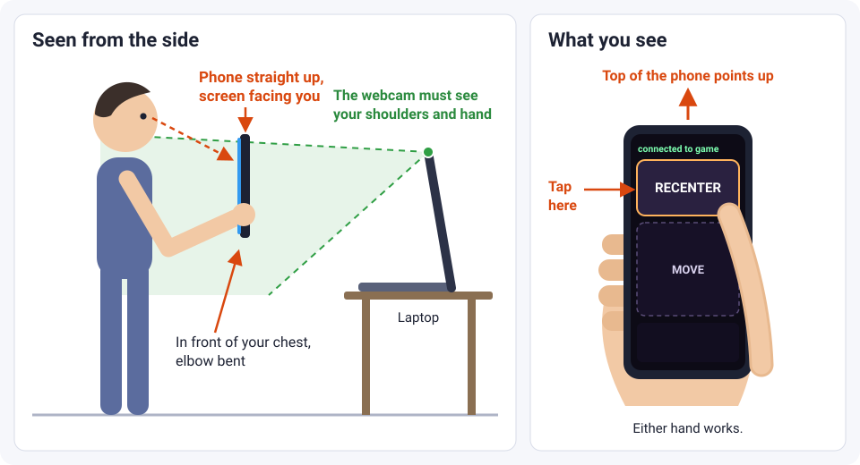

# Air Ping Pong

Play ping pong in your browser with **your phone as the racket**.

- The **laptop** runs the game.
- The **phone** gives the racket's angle and swing.
- The **webcam** follows your hand to move the racket left and right.

It is a proof of concept: plain HTML and JavaScript with one small Node server, and no build step.

## What you need

- A laptop with a webcam and [Node.js](https://nodejs.org) 18 or newer
- A phone with a gyroscope, using **Chrome** (built for Android; the iPhone code is included but has not been tested)
- The phone and laptop on the **same Wi-Fi**
- Internet access, to load the camera tracking models

## Install

```bash
git clone https://github.com/Redalamr/air-ping-pong.git
cd air-ping-pong
npm install
```

## Play

**1. Start the server**

```bash
npm start
```

**2. Open the game on the laptop**

Go to `https://localhost:8443`. The browser shows a security warning because the server makes its own certificate. Click **Advanced**, then **Continue**.

**3. Connect the phone**

Scan the QR code on the laptop and open the link in Chrome. Accept the same warning (**Advanced**, then **Proceed**), then tap **Start**. The laptop should show `phone connected, ~60 Hz`.

**4. Get into position and tap RECENTER**

Stand or sit so the webcam can see your **shoulders and the hand holding the phone**. Hold the phone **straight up in front of your chest, with the screen facing you**, like this:



Tap **RECENTER**. The game starts, and the place where your hand is now becomes the middle of the table.

**5. Allow the camera**

Click **Allow** if the laptop asks. Then click once anywhere on the game to turn on the laptop's sound.

**6. Serve**

Turn the screen toward the laptop, hold still for a moment, then **flick your wrist forward** through the floating ball.

## Controls

| What you do | What the racket does |
| --- | --- |
| Move your hand left or right | Travels left or right |
| Turn the screen toward the laptop | Forehand (red side) |
| Turn the back of the phone toward the laptop | Backhand (black side) |
| Tilt the top of the phone toward you | Opens the face, so the ball goes higher |
| Tilt the top of the phone toward the laptop | Closes the face, so the ball stays lower |
| Hold still when the ball arrives | Blocks |
| Flick your wrist forward | Hits a drive |
| Tilt the phone 45 to 60 degrees sideways and brush upward | Hits topspin |
| Slide your thumb on the **MOVE** pad | Moves the racket without the camera |

The racket's height is automatic. When the CPU hits, a **ring** shows where the ball will arrive. It turns **green** when your racket is there. If you get close, the racket snaps onto the ball, except on the `pro` assist level.

### Keyboard (on the laptop)

| Key | Action |
| --- | --- |
| `T` | Switch between phone and hand or mouse |
| `C` | Turn camera tracking off or on |
| `H` | Follow your other hand |
| `D` | Show the debug panel |
| `X` | Flip left and right |
| `1` `2` `3` | CPU level |
| `A` | Assist level (casual, normal, pro) |
| `R` | Show or hide the guides |
| `V` | Show or hide the camera picture |
| `M` | Mute |
| `P` | Pause |
| `F` | Full screen |

You can also play without a phone: choose **Start camera and sound** or **Play with the mouse instead** on the start screen.

## Adjust the feel

Open the browser console on the laptop (`F12`) and change a value. It applies immediately.

```js
APP.C.CAM_REACH = 0.6   // how far the racket moves when your hand moves (default 0.4)
APP.C.SWING_GAIN = 0.7  // how strong your swing is (default 0.5)
APP.C.PHONE_DRAG = 3    // how far the MOVE pad moves the racket (default 2.4)
```

For the swing, press `D` and play a relaxed forehand. The `peak` line should read about 2 m/s. To keep a value, change it in the `C` block at the top of the script in `air-ping-pong.html`.

## Troubleshooting

| Problem | Fix |
| --- | --- |
| The phone can't open the page | Check that both devices are on the same Wi-Fi. Guest and campus networks often block this, so use the [tunnel](#if-the-phone-cant-reach-the-laptop). |
| Windows blocks the connection | In an admin PowerShell: `New-NetFirewallRule -DisplayName "Air Ping Pong" -Direction Inbound -Protocol TCP -LocalPort 8443 -RemoteAddress LocalSubnet -Action Allow` |
| The security warning came back | The server makes a new certificate each time it starts. Accept it again on both devices. |
| `No motion events` on the phone | In Chrome, open the site settings and allow **Motion sensors**. |
| The racket points the wrong way | Hold the phone as in the picture and tap **RECENTER** again. Do this whenever it drifts. |
| The racket doesn't follow your hand | Press `D` and read the `camera` line. If it says `no hand seen`, move back until the webcam sees your shoulders and hand, and improve the lighting. |
| It follows your other hand | Press `H`. |
| Left and right are reversed | Press `X`. |
| The game lags | Press `C` to turn the camera off and use the **MOVE** pad. |
| No buzz on a hit | Turn on vibration in the phone's settings and turn off Do Not Disturb. |
| No click on a hit | Turn up the phone's media volume. |
| `Port 8443 is already in use` | Close the other server, then run `npm start` again. |

### If the phone can't reach the laptop

Install [cloudflared](https://developers.cloudflare.com/cloudflare-one/connections/connect-networks/downloads/) and run this in a second terminal:

```bash
cloudflared tunnel --url http://localhost:8080
```

Copy the `https://....trycloudflare.com` address it prints, then restart the server with it.

PowerShell:

```powershell
$env:PUBLIC_URL="https://your-address.trycloudflare.com"; npm start
```

macOS or Linux:

```bash
PUBLIC_URL="https://your-address.trycloudflare.com" npm start
```

The QR code now uses the tunnel. Anyone with the full link can join your room while the tunnel runs, so close it when you finish.

## Project files

| File | Purpose |
| --- | --- |
| `air-ping-pong.html` | The game: physics, CPU, drawing, and hand, mouse and phone input |
| `phone.html` | The controller page that runs on the phone |
| `server.js` | Serves both pages and relays messages between the phone and the game |
| `docs/how-to-hold.svg` | The drawing in this guide |
